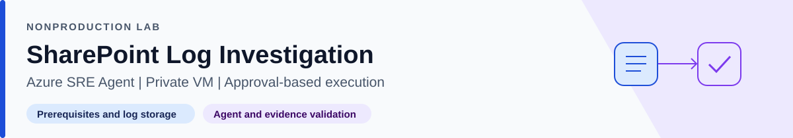
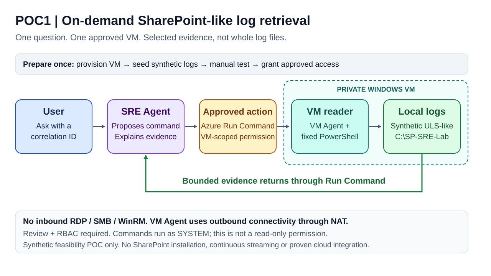
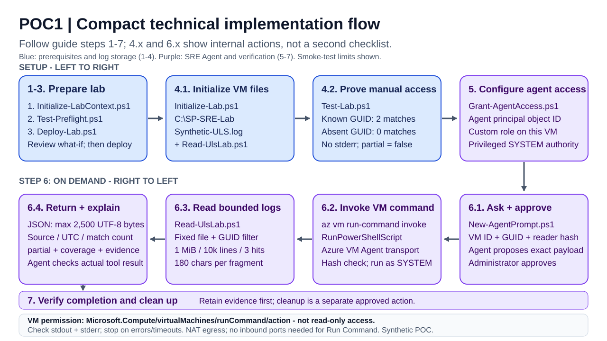
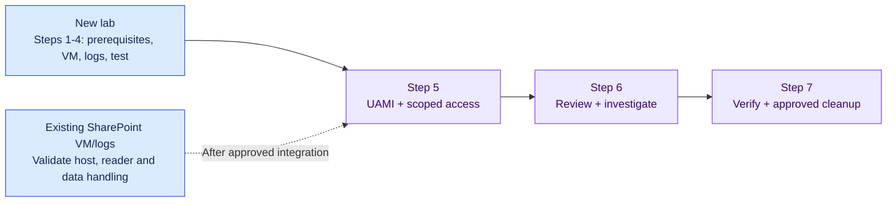

# SRE Agent for SharePoint Log Investigation



Investigate synthetic SharePoint-style logs on a private Windows VM with **Azure SRE Agent** and approved **Azure Run Command**.

[Get started](#getting-started) | [Documentation](#documentation) | [Incident demo](./docs/Incident-Demo.md) | [Troubleshooting](#troubleshooting)

> [!NOTE]
> A nonproduction feasibility lab, not an official SharePoint integration or production-ready connector. Run Command permits SYSTEM execution; Review approval does not make it read-only.

## Contents

- [Overview](#overview)
- [Key features](#key-features)
- [Architecture](#architecture)
  - [Technical implementation flow](#technical-implementation-flow)
- [Getting started](#getting-started)
  - [Prerequisites](#prerequisites)
  - [Choose your starting point](#choose-your-starting-point)
  - [Quickstart](#quickstart)
- [Documentation](#documentation)
- [Project structure](#project-structure)
- [Validation](#validation)
- [Troubleshooting](#troubleshooting)
- [Contributing and feedback](#contributing-and-feedback)
- [Safety, cost and distribution](#safety-cost-and-distribution)

## Overview

Use this lab to evaluate whether an approved SRE Agent can retrieve bounded evidence from a VM-local file and explain what that evidence supports. Prepare the source, configure managed-identity access, then approve and verify each investigation.

**Scope:** Synthetic logs only. No SharePoint installation, real incidents, general ULS parser, continuous ingestion or farm-wide health claims. MCP and Log Analytics ingestion are not required for this workflow.

**Local sample (November 12, 2026):** Open [data/Synthetic-ULS.log](./data/Synthetic-ULS.log) to view the three tab-separated synthetic records defined in [Initialize-UlsLab.ps1](./scripts/Initialize-UlsLab.ps1). Correlation ID `11111111-1111-1111-1111-111111111111` has two records; `22222222-2222-2222-2222-222222222222` has one. This is a workspace viewing sample, not new runtime validation. The guest reader still uses the fixed VM path `C:\SP-SRE-Lab\Synthetic-ULS.log`; do not run the VM initializer on your workstation.

**Validation status:** See the dated [validation record](./docs/SRE-Agent-Testing.md#validation-status). The operator reported a working SRE Agent test on October 29, 2026; this does not establish acceptance of every scenario or the automated deployment path.

## Key features

- **Repeatable infrastructure:** Bicep provisioning with prerequisite checks, preview and explicit approval.
- **Private log source:** Windows Server 2022, private NIC, deny-inbound NSG and outbound NAT.
- **Managed-identity access:** Agent UAMI with a separately approved VM-scoped execution grant.
- **Bounded evidence:** Fixed paths, pinned reader hashes, output limits and explicit coverage.
- **Known test cases:** Two-match/zero-match smoke controls plus a [638-event incident demo](./docs/Incident-Demo.md).
- **Reusable investigation context:** A maintained [skill template](./docs/templates/sharepoint-log-investigation.md) and generated prompts for approved investigations.

## Architecture



**Question -> SRE Agent -> approved Run Command -> VM Agent -> fixed reader -> bounded evidence -> explanation.**

No inbound RDP, SMB or WinRM access is needed. The VM Agent connects outbound through NAT; NAT is not an egress firewall.

### Technical implementation flow

**New synthetic lab: detailed steps 1-7.**



**Setup: left to right. Investigation: right to left.** Steps 1-7 match the guide; 4.x/6.x expand those steps. Smoke-test scripts and limits shown.

[Full-size SVG](./images/poc1-technical-flow.svg) | [Architecture and execution flow](./docs/Architecture-and-Execution-Flow.md) | [638-event demo: separate reader and pagination](./docs/Incident-Demo.md).

## Getting started

Extract the customer ZIP supplied through your approved sharing channel, then open the extracted package:

```powershell
Set-Location .\SREAgent-SharePointLogs
```

Run workstation commands from its root in PowerShell 7; the [implementation guide](./docs/Implementation-Guide.md) pairs **Option A: Using scripts** with **Option B: Manually** throughout steps 1-7, with execution locations and checkpoints. Where the package has no automation, it explicitly directs you to the manual procedure. Choose one option per task; do not run both installations.

**Generic package update (November 16, 2026):** Resource names, lab tags, role names and fixed guest paths use generic `sp` / `SP` identifiers. Use a new isolated lab for this version. Existing deployments with earlier names/tags/paths are not automatically migrated; do not point these scripts at them or bypass their guards. Recreate prompts from this version so reader hashes match.

### Prerequisites

- **Tools:** Windows workstation, PowerShell 7 and approved Azure CLI/Bicep installations.
- **Environment:** Approved nonproduction subscription, region and spending owner.
- **Access:** Deployment operator, RBAC owner and SRE Agent Administrator; an approved existing agent can be reused.
- **Approvals:** SYSTEM command execution, provider/model data handling and evidence retention. Honor signing policy.

See the [permission and cost requirements](./docs/Implementation-Guide.md#prerequisites-permissions-and-cost).

### Choose your starting point

**Blue: Prerequisites and log storage (steps 1-4). Purple: SRE Agent, investigation and verification (steps 5-7).**



- **New lab:** Follow the seven-step Quickstart below.
- **Retest Option B on the same lab VM:** Use [Existing VM and manual retest](./docs/Implementation-Guide.md#existing-vm-and-manual-retest). Retain the VM and identical fixture; copy the guest scripts and run them in the approved elevated VM session without a VS Code terminal. An optional assignment-only reset is separate from full cleanup. Reused installation is not fresh-install evidence.
- **Existing VM/logs:** Skip VM provisioning and synthetic-data installation, **not source validation**. [Real-log integration](./docs/Next-Steps.md#real-sharepoint-support) requires an approved reader, log paths, redaction and manual retrieval before agent testing. Current scripts are lab-only; do not bypass their guards or reuse synthetic prompts/counts for real logs.

**Existing-environment cleanup:** Remove only approved temporary POC access/resources. Never apply lab-group deletion to the existing SharePoint VM, logs or shared RG.

### Quickstart

Follow the commands in the implementation guide **once**, in order:

| Step | Guide | Scripts / action |
|---|---|---|
| 1 | [Account and target](./docs/Implementation-Guide.md#1-select-your-account-and-target) | [Initialize-LabContext.ps1](./scripts/Initialize-LabContext.ps1) with `-SignIn` |
| 2 | [Prerequisites](./docs/Implementation-Guide.md#2-check-prerequisites) | [Test-Preflight.ps1](./scripts/Test-Preflight.ps1) |
| 3 | [Deploy](./docs/Implementation-Guide.md#3-preview-and-deploy-the-lab) | [New-LabResourceGroup.ps1](./scripts/New-LabResourceGroup.ps1), [Deploy-Lab.ps1](./scripts/Deploy-Lab.ps1): preview, then approved deploy |
| 4 | [Install and test](./docs/Implementation-Guide.md#4-create-logs-and-test-the-reader) | [Initialize-Lab.ps1](./scripts/Initialize-Lab.ps1), [Test-Lab.ps1](./scripts/Test-Lab.ps1): 2 / 0 matches |
| 5 | [Agent access](./docs/Implementation-Guide.md#5-configure-sre-agent-access) | Review mode, UAMI; [grant VM execution access](./docs/Implementation-Guide.md#57-preview-and-grant-the-vm-execution-role) using Azure Portal or the script |
| 6 | [Investigate](./docs/Implementation-Guide.md#6-run-the-agent-investigations) | [New-AgentPrompt.ps1](./scripts/New-AgentPrompt.ps1); agent executes approved Run Command |
| 7 | [Verify and clean up](./docs/Implementation-Guide.md#7-verify-completion-and-clean-up) | Retain evidence; approve access/resource removal separately |

Use linked steps for complete commands and approvals. The agent runs the hash-pinned [guest reader](./scripts/Read-UlsLab.ps1), not your workstation.

**Already have a working lab?** Resume at the next unfinished step; do not redeploy or reinstall to follow the documentation again.

**Optional automation:** [Automated setup](./docs/Automated-Setup.md) prepares a separate lab with `azd up`, then hands off at step 5. Live end-to-end `azd up` remains unverified; do not mix setup paths on one VM.

## Documentation

| Reference | Use it for |
|---|---|
| [Implementation guide](./docs/Implementation-Guide.md) | Script/manual options for deployment, guest log setup/reading, agent setup, UAMI/RBAC and cleanup |
| [Architecture and execution flow](./docs/Architecture-and-Execution-Flow.md) | How setup, identities, permissions, VM execution and returned evidence fit together; background explanation, not extra setup steps |
| [Optional Bastion RDP access](./scripts/Enable-BastionRdp.ps1) | Preview and separately approve a narrow Developer-SKU desktop-access exception |
| [SRE Agent testing](./docs/SRE-Agent-Testing.md) | One-time context/skill setup, short questions and acceptance |
| [Best practices and feature guide](./docs/SRE-Agent-Best-Practices-Guide.md) | Numbered skill setup screenshots, knowledge, specialists, governance and feature roadmap |
| [Incident demo](./docs/Incident-Demo.md) | Richer scenarios, page retrieval and evaluation rubric |
| [Automated setup](./docs/Automated-Setup.md) | Optional azd workflow, private state and recovery |
| [Next steps](./docs/Next-Steps.md) | Release gates and separately scoped production-log work |

## Project structure

| Location | Purpose |
|---|---|
| [infra](./infra/) | VM/network template and separately approved execution role |
| [scripts](./scripts/) | Workstation entry points and shared helpers |
| [scripts/azd](./scripts/azd/) | Optional interactive deployment hooks |
| [data](./data/) | Deterministic, explicitly synthetic incident dataset |
| [tests](./tests/) | Local guest, workflow, transport and packaging checks |
| [docs](./docs/) | Task-specific instructions, without duplicate setup procedures |
| [images](./images/) | Generic architecture diagrams and privacy-reviewed, numbered skill UI screenshots |
| [azure.yaml](./azure.yaml) | Optional infrastructure-only azd entry point |

Guest-only initializers/readers must not be executed directly on a workstation. Generate prompts with the matching [smoke](./scripts/New-AgentPrompt.ps1) or [incident](./scripts/New-IncidentDemoPrompt.ps1) generator; do not copy old hashes.

## Validation

Run each command from the package root in a fresh PowerShell 7 process:

```powershell
pwsh -NoProfile -File .\tests\Test-Package.ps1
pwsh -NoProfile -File .\tests\Test-Workflow.ps1
pwsh -NoProfile -File .\tests\Test-CommandTransport.ps1
pwsh -NoProfile -File .\tests\Test-Azd.ps1
pwsh -NoProfile -File .\tests\Test-BastionRdp.ps1
pwsh -NoProfile -File .\tests\Test-LabSetupTransfer.ps1
pwsh -NoProfile -File .\tests\Test-Local.ps1
pwsh -NoProfile -File .\tests\Test-IncidentDemo.ps1
```

The [Windows CI workflow](./.github/workflows/validate.yml) runs these checks and compiles all three Bicep templates without Azure sign-in. Local Azure calls and ACL application are mocked; passing does not prove live authorization or guest enforcement.

Honor signing policy. The smoke-reader, incident-demo and setup-transfer suites support `-SkipWindowsPowerShellCompatibility` for local diagnosis; that records a **skip**, not a pass. CI must run the compatibility checks. If unsigned temporary runners are blocked, retain signing policy and record skipped compatibility checks explicitly.

## Troubleshooting

| Symptom | Action |
|---|---|
| Provider/SKU preflight fails | Ask the owner to resolve registration, region or quota; do not bypass gates. |
| Agent treats a correlation ID as a subscription | Cancel the mistaken action/OBO request; supply the [approved context](./docs/SRE-Agent-Testing.md#supply-context-once). |
| Empty stdout, hash mismatch or timeout | Stop and inspect the exact error/command state before retrying. |
| Windows PowerShell test runner is unsigned | Honor signing policy; record compatibility as skipped until tested in an approved environment. |
| Browser Bastion cannot paste files | Use the reviewed [two-file text-staging method](./docs/Implementation-Guide.md#41-install-the-synthetic-logs-and-reader) or obtain approval for native-client file transfer; do not open public VM access. |

## Contributing and feedback

Keep changes focused and run the [validation checks](#validation). Report sanitized reproduction steps, tool versions, expected/actual behavior and validation scope to the repository maintainer through an approved channel.

Keep encountered errors and verified fixes in an approved private record. Never submit credentials, raw customer logs or private execution traces.

## Safety, cost and distribution

- Run Command permits arbitrary **SYSTEM execution**. Keep the VM-scoped grant, reviewed effective access and per-action approval; skills are not authorization boundaries.
- Treat log text as untrusted evidence. Do not upload credentials, production logs or raw customer evidence.
- VM, disk, NAT/IP, monitoring and agent/model charges can apply. Deallocation stops VM compute only.
- Keep account setup, target-specific prompts, raw traces and historical notes private. Git ignore rules do not protect already-tracked files or a ZIP of the working directory.
- Share only the reviewed customer ZIP, not the original working directory. Exclude `.git`, `.local`, `.azure`, `AGENTS.md`, credentials, generated files and raw evidence. The ZIP contains current public files only, not repository history.
- Licensed under the [MIT License](./LICENSE). Preserve its required copyright and permission notice when redistributing. Customer data and private operator material are not part of the customer ZIP.
