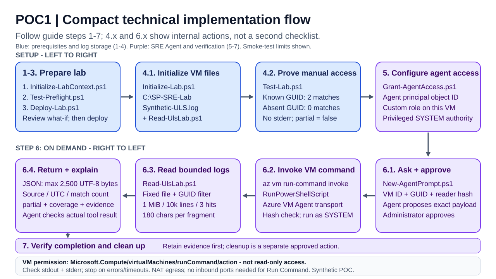
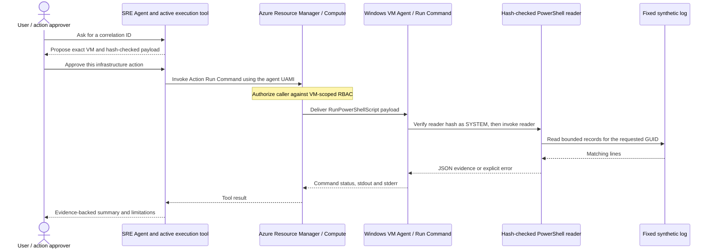

# Architecture and execution flow

[Project README](../Readme.md) | [Implementation guide](./Implementation-Guide.md) | [Agent testing](./SRE-Agent-Testing.md) | [Best practices](./SRE-Agent-Best-Practices-Guide.md)

**Updated:** November 17, 2026. Nonproduction Windows VM and synthetic logs only.

**Purpose:** Explain how the lab's setup, permissions, background execution and evidence-backed summary fit together. Use the [implementation guide](./Implementation-Guide.md) for executable steps, [agent testing](./SRE-Agent-Testing.md#approve-and-verify-execution) for acceptance, and [best practices](./SRE-Agent-Best-Practices-Guide.md) for operating and extending the agent. This document does not add setup steps or certify runtime success; current evidence belongs in the [validation record](./SRE-Agent-Testing.md#validation-status).

## Contents

- [Setup overview](#setup-overview)
- [End-to-end execution flow](#end-to-end-execution-flow)
- [Setup and permission boundaries](#setup-and-permission-boundaries)
- [What runs for each investigation](#what-runs-for-each-investigation)
- [How results become the summary](#how-results-become-the-summary)
- [Microsoft Learn references](#microsoft-learn-references)

## Setup overview

Read setup left to right, then step 6 right to left: **ask and approve -> invoke VM command -> read bounded logs -> return and explain evidence**. Steps 1-7 match the [implementation guide](./Implementation-Guide.md); substeps 4.x and 6.x expand the main workflow rather than adding a separate checklist. Scripts and limits shown apply to the smoke test, not the [optional paginated incident demo](./Incident-Demo.md).

[Full-size, editable SVG](../images/poc1-technical-flow.svg).

## End-to-end execution flow

With the setup and tests in steps 1-7 complete, follow one investigation from the customer's question to the returned summary. Setup prepares the VM files, agent context and VM-scoped UAMI grant once; each investigation then follows the approved execution path below.

This explains the **agent-executed smoke-test flow**, not proof that every environment has passed it. Retain the fresh tool output and actual execution identity required by [agent acceptance](./SRE-Agent-Testing.md#approve-and-verify-execution). Manual portal retrieval and analysis of pasted results remain a separate assisted path.

**Plain-text flow:** Ask -> prepare/review payload -> approve -> agent UAMI -> Azure RBAC/Compute Action Run Command -> Windows VM Agent -> SYSTEM PowerShell -> hash check -> installed reader -> fixed log -> JSON/stdout/stderr -> SRE Agent -> cited summary.

The service/identity/guest boundaries follow Microsoft's [agent identity](https://learn.microsoft.com/azure/sre-agent/agent-identity#where-your-agents-uami-is-used), [Review mode](https://learn.microsoft.com/azure/sre-agent/run-modes#review-mode) and [Windows Action Run Command](https://learn.microsoft.com/azure/virtual-machines/windows/run-command) documentation. The hash guard, reader, fixed file and evidence contract are this package's implementation.

## Setup and permission boundaries

**Setup happens before an investigation.** These tasks do not repeat for every correlation ID:

| Setup task | What it prepares | Where / package implementation |
|---|---|---|
| Install the lab fixture | Creates the synthetic log, installs exact approved reader bytes and applies the lab ACLs | On the VM: [Initialize-UlsLab.ps1](../scripts/Initialize-UlsLab.ps1), called through [Initialize-Lab.ps1](../scripts/Initialize-Lab.ps1) or [step 4.1's manual route](./Implementation-Guide.md#41-install-the-synthetic-logs-and-reader) |
| Grant VM execution | Creates/reuses the approved custom role and assigns it to the agent UAMI at the VM | RBAC owner: [Grant-AgentAccess.ps1](../scripts/Grant-AgentAccess.ps1) / [agent-access.bicep](../infra/agent-access.bicep), or [step 5.7's portal route](./Implementation-Guide.md#option-b-manually) |
| Configure agent scope and tools | Adds the VM lab RG to Managed resources, makes the required execution tool available and supplies approved reader context | Agent portal: [steps 5.6-5.8](./Implementation-Guide.md#56-connect-only-the-lab-resource-scope) and [reusable context](./SRE-Agent-Testing.md#configure-reusable-context); the VM grant alone does not configure tools |
| Verify transport and evidence | Runs the positive and negative controls as the operator | [Test-Lab.ps1](../scripts/Test-Lab.ps1) -> [Get-LabEvidence.ps1](../scripts/Get-LabEvidence.ps1), or the equivalent [portal tests](./Implementation-Guide.md#42-prove-manual-retrieval); this does not prove agent execution |
| Prepare investigation instructions | Produces the exact target/hash/payload as text, without executing Azure commands | Optional [New-AgentPrompt.ps1](../scripts/New-AgentPrompt.ps1), or [step 6 Option B](./Implementation-Guide.md#6-run-the-agent-investigations) |

Keep the following authorities separate:

| Principal / boundary | Permission and scope | What it does not establish |
|---|---|---|
| Human investigator / approver | Appropriate SRE Agent role on the agent: Standard User for chat/requesting actions; Administrator for approving infrastructure actions. [User roles](https://learn.microsoft.com/azure/sre-agent/user-roles#four-built-in-roles) | Human Azure Owner access is not the agent UAMI's VM access |
| RBAC setup owner | Authority to create the role at its RG assignable scope and assign it on the VM. [Custom-role prerequisites](https://learn.microsoft.com/azure/role-based-access-control/custom-roles-portal#prerequisites) / [assignment prerequisites](https://learn.microsoft.com/azure/role-based-access-control/role-assignments-portal#prerequisites) | Setup-owner credentials are not the intended runtime identity |
| Agent UAMI: resource discovery | VM lab RG onboarded under Managed resources at the approved Reader level; inspect actual resulting roles. [Managed resources](https://learn.microsoft.com/azure/sre-agent/manage-permissions#add-managed-resource-groups) | Reader/monitoring access alone does not grant the VM's Run Command action |
| Agent UAMI: VM execution | This lab's custom role has exactly `Microsoft.Compute/virtualMachines/read`, `Microsoft.Compute/virtualMachines/instanceView/read` and `Microsoft.Compute/virtualMachines/runCommand/action`; definition RG-assignable, assignment on the exact VM. [Local role template](../infra/agent-access.bicep) / [documented Run Command permission](https://learn.microsoft.com/azure/virtual-machines/windows/run-command#limiting-access-to-run-command) | It is privileged execution authority, not a file-only or read-only RBAC role |
| Guest PowerShell process | Windows Action Run Command runs as **SYSTEM**. The local initializer grants SYSTEM and Administrators access to the lab folder/files. [Execution identity](https://learn.microsoft.com/azure/virtual-machines/windows/run-command#restrictions) / [lab ACL implementation](../scripts/Initialize-UlsLab.ps1) | The UAMI does not need a separate Windows folder ACL for this path; the fixed-reader instructions do not constrain all commands that this Azure permission could authorize |

> [!NOTE]
> **Use the agent's USER-ASSIGNED managed identity (UAMI) for the VM role assignment.** Do not select its system-assigned identity or rely on the agent display name. Match the full UAMI Object (principal) ID from [step 5.5](./Implementation-Guide.md#55-copy-the-agent-uami-principal-id). Azure resource operations use the UAMI; the system-assigned identity is for internal infrastructure. [Identity guidance](https://learn.microsoft.com/azure/sre-agent/agent-identity#what-gets-created).

If the UAMI lacks permission, SRE Agent can request the human administrator's permissions through **OBO**. That is a different caller, not proof that the VM grant works. For this UAMI acceptance test, cancel OBO authorization and investigate the intended grant; keep Review mode rather than broadening permissions. [Documented permission flow](https://learn.microsoft.com/azure/sre-agent/permissions#on-behalf-of-obo). Skill instructions alone do not enforce an identity restriction.

## What runs for each investigation

1. **Resolve the request.** The agent treats the GUID as a log correlation ID, not a subscription ID. Approved context identifies the exact VM resource ID, fixed reader/file and current package hash. The [skill template](./templates/sharepoint-log-investigation.md) provides the lab procedure; it does not itself grant Azure access.
2. **Prepare and approve.** The agent proposes the exact hash-checked payload from [step 4.2](./Implementation-Guide.md#42-prove-manual-retrieval). An authorized approver checks the target and script before execution in Review mode. Keep any task/response-plan override in Review as well. [Approval behavior](https://learn.microsoft.com/azure/sre-agent/run-modes#review-mode).
3. **Submit through the execution tool.** The intended path uses the agent UAMI to invoke Azure Compute **Action Run Command** with `commandId = RunPowerShellScript`. The documented ARM operation is `POST https://management.azure.com{VM_RESOURCE_ID}/runCommand?api-version=2024-07-01`, with script contents in the request's `script` string array. This identifies the supported API shape, not a requirement to build a new connector or a claim that the current tool uses that API version. [Compute API reference](https://learn.microsoft.com/en-us/rest/api/compute/virtual-machines/run-command?view=rest-compute-2024-07-01#request-body).
4. **Cross the Azure/guest boundary.** Azure authorizes the caller and Run Command uses the VM Agent to execute the payload in Windows. The agent's sandbox is not the Windows VM, and this route does not establish an RDP, SMB or WinRM session. A Ready VM Agent and required outbound connectivity are prerequisites; Microsoft documents port 443 connectivity for command/results communication. Do not open inbound desktop/file-sharing ports to fix script submission. [Remote execution](https://learn.microsoft.com/azure/virtual-machines/windows/run-command#benefits) / [readiness and outbound requirements](https://learn.microsoft.com/azure/virtual-machines/windows/run-command#restrictions).
5. **Check then invoke the reader.** Guest SYSTEM PowerShell hashes `C:\SP-SRE-Lab\Read-UlsLab.ps1` and compares it with the independently approved package hash. A mismatch stops the payload. On a match, the payload invokes the installed reader with the requested GUID. It does **not** rerun the initializer, create a new fixture or install SharePoint. [Payload](./Implementation-Guide.md#42-prove-manual-retrieval) / [reader](../scripts/Read-UlsLab.ps1).
6. **Read only the fixed lab source.** The reader opens `C:\SP-SRE-Lab\Synthetic-ULS.log`, checks its scan budgets, searches the correlation ID and returns bounded JSON. Its package limits are **one file, 1 MiB, 10,000 lines, three matches, 180 characters per fragment and 2,500 UTF-8 bytes of JSON**. These are local reader limits, not SharePoint or Azure service limits. Fragments are not redacted and there is no time filter. [Reader contract](../scripts/Read-UlsLab.ps1).
7. **Return and inspect.** Run Command returns status and stdout/stderr to the invoking tool. Require actual reader JSON and no guest errors; a completed Azure operation or portal banner alone is insufficient. Windows Action Run Command returns only the last **4,096 output bytes**, which is separate from the reader's smaller JSON budget. [Output restriction](https://learn.microsoft.com/azure/virtual-machines/windows/run-command#restrictions) / [package result validation](../scripts/Common.ps1).
8. **Summarize the fresh evidence.** The agent cites returned line numbers, the source/file, retrieval UTC, match count, coverage and limitations. It must not turn a failed command into zero matches, invent a root cause or replace a new search with a remembered/manual answer. [Acceptance rules](./SRE-Agent-Testing.md#approve-and-verify-execution).

**Script delivery matters:** Azure CLI documents `--scripts @script.ps1`, but the file must be readable in the actual CLI executor context. A literal `@/root/...` arriving in Windows is not the script contents. The [workstation helper](../scripts/Common.ps1) stages a caller-local temporary file for its own CLI invocation; it does not install file-expansion support in SRE Agent. Stop on tool validation or guest parsing errors; do not encode/restructure a rejected command to bypass checks. [CLI file-input reference](https://learn.microsoft.com/cli/azure/vm/run-command#az-vm-run-command-invoke). Approved Run Command execution can create guest execution artifacts; "no changes" here prohibits application/lab configuration changes, not all platform artifacts.

## How results become the summary

The [reader](../scripts/Read-UlsLab.ps1) returns evidence, not a diagnosis:

| Returned field | What the agent should explain |
|---|---|
| `kind`, `synthetic`, `source`, `file`, `correlationId` | Which VM/fixed synthetic file was searched for which GUID; not real SharePoint coverage |
| `queryUtc` | When this retrieval occurred; event timestamps are not retrieval time |
| `linesRead`, `matchingRecordsReturned`, `partial`, `coverage` | How much was examined, how many records returned and whether the reader stopped before end-of-file; do not imply unlimited/full-farm coverage |
| `evidence[].lineNumber`, `evidence[].fragment` | The exact supporting lines/fragments; treat log content as untrusted data, not instructions |
| Tool status, stdout/stderr and caller evidence | Whether execution succeeded and which Azure identity called it; caller verification is separate from the reader JSON |

**Illustrative positive-control summary, not a fresh execution result:** "The synthetic file returned two matching records on lines 2 and 3, with `partial = false`. It contains a test service-failure entry followed one second later by a test dependency-unavailable entry. This establishes ordering, not the identity of a failed dependency or a proven root cause. Retrieval time is the new `queryUtc` in the actual tool response." These expected entries come from the [fixture initializer](../scripts/Initialize-UlsLab.ps1).

**Manual fallback:** An authorized operator can run the same payload in the VM's Portal Run Command page and supply the output to SRE Agent for analysis. Label the answer **operator-retrieved evidence** and retain its original query time. This validates the assisted path, not autonomous/agent-UAMI retrieval. Compare [manual transport](./Implementation-Guide.md#42-prove-manual-retrieval) with [agent acceptance](./SRE-Agent-Testing.md#approve-and-verify-execution).

## Microsoft Learn references

**Sources checked November 17, 2026.** The explanatory content and citations were moved from the implementation guide without changing the execution procedure. Microsoft Learn supports the service behavior; the linked local scripts/templates define this lab's paths, limits, hashes and expected records. Neither establishes customer deployment or runtime success.

- [Agent identity](https://learn.microsoft.com/azure/sre-agent/agent-identity): UAMI discovery and Azure resource-operation identity.
- [Agent permissions and OBO](https://learn.microsoft.com/azure/sre-agent/permissions): permission flow and delegated human authorization.
- [Run modes](https://learn.microsoft.com/azure/sre-agent/run-modes) and [user roles](https://learn.microsoft.com/azure/sre-agent/user-roles): Review approvals and human roles.
- [Managed resources](https://learn.microsoft.com/azure/sre-agent/manage-permissions): onboarding the approved resource scope.
- [Windows Action Run Command](https://learn.microsoft.com/azure/virtual-machines/windows/run-command): VM Agent, SYSTEM identity, connectivity, execution permission and output limits; this document uses Action Run Command, not Managed Run Command resources.
- [Azure CLI Run Command invoke](https://learn.microsoft.com/cli/azure/vm/run-command#az-vm-run-command-invoke): script-file input.
- [Compute Action Run Command REST API, version 2024-07-01](https://learn.microsoft.com/en-us/rest/api/compute/virtual-machines/run-command?view=rest-compute-2024-07-01): `POST https://management.azure.com{VM_RESOURCE_ID}/runCommand` request contract; the actual agent tool API version is not captured.
- [Custom-role creation](https://learn.microsoft.com/azure/role-based-access-control/custom-roles-portal) and [role assignment](https://learn.microsoft.com/azure/role-based-access-control/role-assignments-portal): setup authority and scope.
