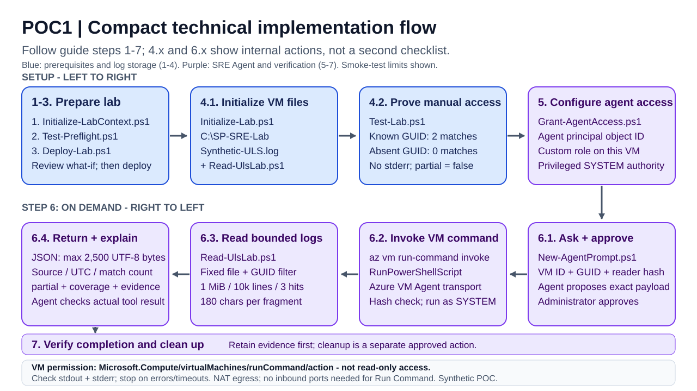

# Implementation guide

[Project README](../Readme.md) | [Agent testing](./SRE-Agent-Testing.md)

**Updated:** October 29, 2026. Nonproduction Windows VM and synthetic logs only.

Use steps **1-7** once. Existing labs resume at the next unfinished step; do not reinstall or redeploy merely to repeat this guide. [Automated setup](./Automated-Setup.md) is an alternative for steps 1-4 on a separate lab.

## Contents

- [Architecture and scope](#architecture-and-scope)
- [Prerequisites, permissions, and cost](#prerequisites-permissions-and-cost)
- [1. Select your account and target](#1-select-your-account-and-target)
- [2. Check prerequisites](#2-check-prerequisites)
- [3. Preview and deploy the lab](#3-preview-and-deploy-the-lab)
- [4. Create logs and test the reader](#4-create-logs-and-test-the-reader)
  - [4.1. Install the synthetic logs and reader](#41-install-the-synthetic-logs-and-reader)
  - [4.2. Prove manual retrieval](#42-prove-manual-retrieval)
  - [Optional realistic incident demo](#optional-realistic-incident-demo)
- [5. Configure SRE Agent access](#5-configure-sre-agent-access)
  - [5.1. Open or create the nonproduction agent](#51-open-or-create-the-nonproduction-agent)
  - [5.2. Complete the Basics fields](#52-complete-the-basics-fields)
  - [5.3. Review the configuration and deploy](#53-review-the-configuration-and-deploy)
  - [5.4. Confirm Review execution mode](#54-confirm-review-execution-mode)
  - [5.5. Copy the agent UAMI principal ID](#55-copy-the-agent-uami-principal-id)
  - [5.6. Connect only the lab resource scope](#56-connect-only-the-lab-resource-scope)
  - [5.7. Preview and grant the VM execution role](#57-preview-and-grant-the-vm-execution-role)
  - [5.8. Verify readiness before the first investigation](#58-verify-readiness-before-the-first-investigation)
- [6. Run the agent investigations](#6-run-the-agent-investigations)
- [7. Verify completion and clean up](#7-verify-completion-and-clean-up)
  - [Acceptance gates and evidence](#acceptance-gates-and-evidence)
  - [Cleanup](#cleanup)
- [Troubleshooting](#troubleshooting)
- [Moving to actual SharePoint logs](#moving-to-actual-sharepoint-logs)

## Architecture and scope

User -> SRE Agent -> approved Run Command -> VM Agent -> hash-pinned reader -> local synthetic file -> bounded JSON evidence.

| Component | Configuration |
|---|---|
| VM | Windows Server 2022 Gen2, Trusted Launch, Standard SSD, persistent `C:` |
| Defaults | `eastus`, `Standard_D2s_v5`; select an approved available combination |
| Network | Private NIC, deny-inbound NSG, outbound NAT; no inbound file share |
| Collection | On demand; no streaming, SharePoint installation, MCP or ingestion |
| Monitoring | Agent monitoring is separate; VM files are not automatically ingested |

NAT is not an egress firewall. Run Command authorizes **arbitrary SYSTEM commands**, not read-only file access. If that authority is unacceptable, stop before the grant.



Read setup left to right, then step 6 right to left: **ask and approve -> invoke VM command -> read bounded logs -> return and explain evidence**. Substeps 4.x and 6.x expand the main workflow; they are not a separate checklist. Scripts and limits shown apply to the smoke test, not the optional paginated incident demo.

[Full-size, editable SVG](../images/poc1-technical-flow.svg).

## Prerequisites, permissions, and cost

- Windows workstation, **PowerShell 7**, Azure CLI and Bicep installed through the approved process.
- Approved public-cloud nonproduction subscription, region, provider/model, data handling and budget.
- Approved SYSTEM execution and evidence retention; no signing-policy bypass.
- Secrets remain in an approved store, not source, command arguments, screenshots or chat.

| Operator | Required authority |
|---|---|
| Deployment operator | Resource creation at approved scope; provider registration may require subscription authority |
| Setup/manual-test operator | VM, instance-view and extension-status reads, plus Run Command on this VM |
| RBAC owner | Role-definition write at the lab RG, role-assignment write on the VM and deployment permissions |
| SRE Agent Administrator | Agent configuration and approval of infrastructure actions |

VM, disk, NAT/IP, monitoring and agent/model charges can apply. Deallocation stops VM compute only.

Workstation readiness checks run as the CLI operator and include extension-status reads. They are separate from the agent's guest payload; do not broaden the agent runtime role to copy operator permissions.

## 1. Select your account and target

**Actions:** Open PowerShell 7 in the package root. Replace the example path; keep this terminal open.

```powershell
Set-Location -LiteralPath 'C:\path\to\azure-sre-agent-sharepoint-logs-lab'
$ErrorActionPreference = 'Stop'
$target = .\scripts\Initialize-LabContext.ps1 -SignIn
$location = 'eastus'
$vmSize = 'Standard_D2s_v5'
```

Enter approved tenant/subscription IDs when prompted. The [context helper](../scripts/Initialize-LabContext.ps1) defaults to generic names `rg-sp-sre-poc1` / `sp-sre-poc1`; pass `-ResourceGroupName` and `-VmName` for another new lab. Earlier customer-specific deployments are not automatically migrated; use a new isolated lab and retain the safety guards.

**Checkpoint:** Displayed account, tenant, subscription and VM match your approval. On failure, stop; do not reuse stale `$target`. In a new terminal, restore context before continuing.

## 2. Check prerequisites

**Actions:** Choose an approved region/size, then pass both explicitly:

```powershell
az bicep version
if ($LASTEXITCODE -ne 0) { throw 'Bicep is unavailable; install it through the approved process.' }
.\scripts\Test-Preflight.ps1 -SubscriptionId $target.SubscriptionId `
    -Location $location -VmSize $vmSize
```

For a restricted SKU, select another approved combination and rerun. There is no automatic region/SKU fallback.

**Checkpoint:** Providers, image, quota and SKU checks pass. Preflight creates no resources and does not reserve capacity.

## 3. Preview and deploy the lab

**Actions:** For a **new lab only**, create a dedicated group. Do not adopt or retag a shared group.

```powershell
.\scripts\New-LabResourceGroup.ps1 -SubscriptionId $target.SubscriptionId `
    -ResourceGroupName $target.ResourceGroupName -Location $location
.\scripts\Deploy-Lab.ps1 @target -Location $location -VmSize $vmSize -Mode Preview
```

After approving the target, changes and costs:

```powershell
.\scripts\Deploy-Lab.ps1 @target -Location $location -VmSize $vmSize -Mode Deploy
```

Use the masked password prompts; input may be requested again for deployment. On failure, inspect partial state before retrying.

**Checkpoint:** Deployment `Succeeded`; private VM is running and VM Agent is ready. A preview or declined deployment is not completion.

## 4. Create logs and test the reader

### 4.1. Install the synthetic logs and reader

**Actions:** Approve the SYSTEM installation on the verified VM:

```powershell
.\scripts\Initialize-Lab.ps1 @target
```

Creates `Synthetic-ULS.log` and `Read-UlsLab.ps1` under **VM path** `C:\SP-SRE-Lab`, with SYSTEM/Administrators permissions. Do not execute guest-only scripts on the workstation. Identical files are retained; changed files are refused.

**Checkpoint:** `kind = uls-lab-initialized`, `synthetic = true` and returned reader hash matches the repository.

### 4.2. Prove manual retrieval

**Actions:**

```powershell
.\scripts\Test-Lab.ps1 @target
```

**Checkpoint:** Exactly **2** positive matches and **0** absent-control matches, `partial = false`, correct VM/file and no errors. This verifies manual transport, not agent execution.

Smoke-reader limits: one file, 1 MiB, 10,000 lines, 3 matches, 180 characters per fragment and 2,500 UTF-8 output bytes. Shortening is not redaction.

### Optional realistic incident demo

Use the separate [incident walkthrough](./Incident-Demo.md) to install and test 638 events without changing the smoke fixture. It has its own reader, prompt generator and pagination contract. Do not repeat an already verified installation.

## 5. Configure SRE Agent access

Start at 5.1 for a new agent, or 5.4 for an existing approved agent. Creation requires **Owner**, or **Contributor plus User Access Administrator**, at the creation scope; activate approved PIM access if needed. [Microsoft setup](https://learn.microsoft.com/azure/sre-agent/create-and-set-up).

### 5.1. Open or create the nonproduction agent

**Actions:** Sign in at [sre.azure.com](https://sre.azure.com) with the approved directory/account. Open an existing agent, or select **Create agent**.

**Checkpoint:** Correct agent open, or new-agent **Basics** form displayed.

### 5.2. Complete the Basics fields

| Field | Selection |
|---|---|
| Subscription | Approved nonproduction subscription |
| Resource group | Separate agent RG, not the VM lab RG |
| Agent name / region | Unique lab name and currently available approved region |
| Provider / model | Organization-approved selection; review processing terms and charges |
| User-assigned managed identity | **Create new**, or deliberately select an approved existing UAMI |
| Application Insights | Create new unless an approved instance should be reused |

**Actions:** Complete all required fields. Empty **Use existing** identity selection blocks Next. Do not assume one provider's region/data-boundary terms apply to another.

**Checkpoint:** Settings approved; required fields complete; Next enabled.

### 5.3. Review the configuration and deploy

**Actions:** Review subscription, RG, region, provider, identity and monitoring. After owner approval, deploy once, wait for completion and select **Set up your agent**.

The agent, UAMI, role assignments and monitoring are distinct resources. Application Insights/workspace support agent monitoring; they do not automatically ingest VM files.

**Checkpoint:** Deployment succeeds and the agent opens with your SRE Agent Administrator access. Provisioning success is not proof of VM execution.

### 5.4. Confirm Review execution mode

**Actions:** Open **Settings > Basics** and confirm **Review**. This is execution mode, not the wizard's Review page. If using a plan/task, its autonomy setting can override the default; set that to Review too.

**Checkpoint:** Infrastructure actions require authorized approval. If the setting is unavailable, contact the agent administrator. [Run modes](https://learn.microsoft.com/azure/sre-agent/run-modes).

### 5.5. Copy the agent UAMI principal ID

**Actions:** Open **Settings > Azure settings > Managed Identity > Go to Identity**. On the linked UAMI, copy **Object (principal) ID**.

Use this UAMI for the VM grant, **not** its client ID, the system-assigned identity, the VM identity or your user account. Runtime uses managed identity without storing your password. The RBAC owner's CLI sign-in is a separate, one-time setup identity.

**Checkpoint:** Exact agent UAMI principal GUID copied. [Agent identity](https://learn.microsoft.com/azure/sre-agent/agent-identity).

### 5.6. Connect only the lab resource scope

**Actions:** In the agent, open **Build + Set up > Managed resources > Add resource group**. Labels can vary by portal version.

1. Select the **VM lab RG checkbox**, not the agent RG or whole subscription.
2. Select **Reader**, not **Privileged**. Have the RBAC owner review every proposed role and scope.
3. On **View agent permissions**, select **Add resource group**; wait for propagation.

**Needed** means pending permission. Environment-specific portal screenshots are intentionally omitted from this package.

On the initial setup page, the alternative is **Quickstart > Azure resources > Add resources > Resource group**. Use one path, not both; do not recreate an agent to find the menu.

**Checkpoint:** Lab RG appears in Managed resources. Reader onboarding does not grant Run Command or remove inherited privileges. [Current management reference](https://learn.microsoft.com/azure/sre-agent/manage-permissions#add-managed-resource-groups).

### 5.7. Preview and grant the VM execution role

**Choose one method:** [Azure Portal](#option-a---azure-portal) or the [PowerShell script](#option-b---powershell-script). Both use the same three permissions with a VM-only assignment. Complete steps 5.1-5.6 first; inspect existing assignments and do not duplicate a correct grant.

#### Option A - Azure Portal

**Prerequisites:** The RBAC owner needs authority to create custom roles at the lab resource-group scope and assign roles on the VM. See [custom-role prerequisites](https://learn.microsoft.com/azure/role-based-access-control/custom-roles-portal#prerequisites) and [role-assignment prerequisites](https://learn.microsoft.com/azure/role-based-access-control/role-assignments-portal#prerequisites). Have the approved VM/resource group and the agent UAMI's **Object (principal) ID** from [step 5.5](#55-copy-the-agent-uami-principal-id) ready.

**1. Create the custom role at the lab resource group**

Follow the [Azure Portal custom-role procedure](https://learn.microsoft.com/azure/role-based-access-control/custom-roles-portal#start-from-scratch):

1. Open **Resource groups > your VM lab resource group > Access control (IAM) > Add > Add custom role**.
2. On **Basics**, set **Baseline permissions = Start from scratch**. Use a directory-unique name such as `SP SRE POC1 Run Command - <unique-lab-suffix>` and description `Privileged SYSTEM command execution on the approved lab VM; not a read-only file role`. [Role naming](https://learn.microsoft.com/azure/role-based-access-control/custom-roles-portal#step-3-basics).
3. On **Permissions > Add permissions**, find **Microsoft.Compute** and select only the following **Actions**, matching the [lab role template](../infra/agent-access.bicep):

   ```text
   Microsoft.Compute/virtualMachines/read
   Microsoft.Compute/virtualMachines/instanceView/read
   Microsoft.Compute/virtualMachines/runCommand/action
   ```

4. On **Assignable scopes**, retain **only the VM lab resource group**, not the subscription. This makes the role available for assignment within the group; it does not grant access by itself. [Assignable scopes](https://learn.microsoft.com/azure/role-based-access-control/custom-roles-portal#step-5-assignable-scopes).
5. On **JSON**, verify the three exact Actions, empty `notActions`, `dataActions` and `notDataActions`, and only the approved resource group in `assignableScopes`. Select **Review + create**, review and then **Create**. [JSON review](https://learn.microsoft.com/azure/role-based-access-control/custom-roles-portal#step-6-json).

**2. Assign the role on the specific VM**

Follow the [Azure Portal role-assignment procedure](https://learn.microsoft.com/azure/role-based-access-control/role-assignments-portal):

1. Open **Virtual machines > your approved VM > Access control (IAM) > Add > Add role assignment**. Do not start this assignment from the resource group or subscription.
2. On **Role**, search for and select the custom role created above.
3. On **Members**, choose **Managed identity > Select members**. Select the subscription containing the agent identity, choose **User-assigned managed identity**, then select the **SRE Agent's UAMI**, not the VM identity or your user account. Verify its Object (principal) ID against step 5.5. [Managed-identity selection](https://learn.microsoft.com/azure/role-based-access-control/role-assignments-portal#step-4-select-who-needs-access).
4. On **Review + assign**, confirm the exact role, intended UAMI and **specific VM scope**. Only after owner approval, select the final **Review + assign**. These are manual review checkpoints, not an ARM/Bicep what-if preview. [Assignment review](https://learn.microsoft.com/azure/role-based-access-control/role-assignments-portal#step-7-assign-role).

**3. Verify and continue**

In **VM > Access control (IAM) > Role assignments**, confirm the custom role, intended UAMI, **Type = Managed identity** and **Scope = This resource**. Review inherited access as well; the new VM-scoped grant does not remove other access. Then continue to [step 5.8](#58-verify-readiness-before-the-first-investigation). Successful assignment alone is not agent acceptance. [Assignment scopes](https://learn.microsoft.com/azure/role-based-access-control/role-assignments-portal#step-1-identify-the-needed-scope).

**Safety:** Action Run Command permits privileged commands, and Windows scripts run as **SYSTEM**. This is not read-only log access. Retain the agent's Review-mode approval requirement; do not substitute a broader role for convenience. [Run Command permissions](https://learn.microsoft.com/azure/virtual-machines/windows/run-command#limiting-access-to-run-command) and [execution restrictions](https://learn.microsoft.com/azure/virtual-machines/windows/run-command#restrictions).

**Portal cleanup:** Record the role/assignment IDs privately and follow the [portal-created grant cleanup](#cleanup), not the scripted deployment-output commands.

**References checked November 16, 2026:** [Create a custom role](https://learn.microsoft.com/azure/role-based-access-control/custom-roles-portal) | [Assign a role](https://learn.microsoft.com/azure/role-based-access-control/role-assignments-portal) | [Windows Action Run Command](https://learn.microsoft.com/azure/virtual-machines/windows/run-command). Portal steps are documentation guidance, not a record of execution in your environment.

#### Option B - PowerShell script

**Actions:** The RBAC owner uses the verified **VM** `@target`. In a separate terminal, repeat step 1 with that owner's account.

Paste the UAMI **Object (principal) ID** at the prompt:

```powershell
$agentPrincipal = Read-Host 'Approved agent UAMI Object (principal) ID'
.\scripts\Grant-AgentAccess.ps1 @target -AgentPrincipalId $agentPrincipal -Mode Preview
```

After reviewing the principal, exact VM, effective access and SYSTEM authority:

```powershell
.\scripts\Grant-AgentAccess.ps1 @target -AgentPrincipalId $agentPrincipal -Mode Deploy
```

**Checkpoint:** For the script method, deployment `Succeeded`; the portal method creates no Bicep deployment record. In **VM > Access control (IAM) > Role assignments**, search **SP SRE POC1 Run Command**. Confirm **Type = Managed identity**, **Scope = This resource**, and the matching Object/principal ID. Review inherited access and allow propagation; do not add duplicate assignments.

The [role template](../infra/agent-access.bicep) permits VM read, instance-view read and Run Command. Its definition is RG-assignable; the assignment is VM-only. This still permits arbitrary **SYSTEM execution**.

### 5.8. Verify readiness before the first investigation

**Actions:** Confirm 5.4-5.7, an available Azure execution tool, and the intended UAMI. RBAC alone does not enable a tool. Configure [reusable context](./SRE-Agent-Testing.md#configure-reusable-context) if users should ask short questions.

**Checkpoint:** Ready to test, not automatically accepted. An OBO request uses the user's permissions; do not silently substitute it for proving the UAMI path.

## 6. Run the agent investigations

Follow [SRE Agent testing](./SRE-Agent-Testing.md) for the single authoritative procedure: supply context once, ask short questions, review the exact payload, and inspect fresh tool results.

**Checkpoint:** Actual agent calls return the expected positive/negative evidence. Manual reads, generated prompts and expected answers are not substitutes.

## 7. Verify completion and clean up

### Acceptance gates and evidence

**Actions:** Use the [test acceptance checks and status record](./SRE-Agent-Testing.md#approve-and-verify-execution). Record target, execution identity, approved hashes, UTC, tool results and coverage privately.

**Checkpoint:** Required tests pass with evidence. Cleanup is separately approved and can be deferred while the lab is needed; account for ongoing costs.

### Cleanup

Stop agent requests. Inspect every resource and confirm the group is dedicated/disposable. Never delete shared agents/resources, unregister providers, or treat conversation deletion as guaranteed evidence erasure.

**Portal-created grant:** If you used the [portal alternative](#option-a---azure-portal), do not use the deployment-output commands below for that grant. After separate approval, remove the exact VM assignment through IAM using your privately recorded role/assignment IDs. Delete the custom role only if no remaining assignments use it and deletion is approved. [Custom-role deletion](https://learn.microsoft.com/azure/role-based-access-control/custom-roles-portal#delete-a-custom-role), checked November 16, 2026.

**Script-created grant - RBAC owner:** Review the exact assignment/role output IDs before removing them:

```powershell
$subscription = $target.SubscriptionId.ToString()
$rg = $target.ResourceGroupName
$vm = $target.VmName
$outputs = az deployment group show --subscription $subscription --resource-group $rg `
    --name "$vm-agent-access" --query properties.outputs --output json
if ($LASTEXITCODE -ne 0) { throw 'Cannot retrieve RBAC output IDs; inspect the deployment.' }
$ids = $outputs | ConvertFrom-Json
$ids | ConvertTo-Json -Depth 4
```

Only after confirming these IDs belong to the approved temporary grant:

```powershell
az role assignment delete --subscription $subscription --ids $ids.roleAssignmentId.value
if ($LASTEXITCODE -ne 0) { throw 'Role assignment cleanup failed.' }
az role definition delete --subscription $subscription --name ($ids.roleDefinitionId.value.Split('/')[-1])
if ($LASTEXITCODE -ne 0) { throw 'Role definition cleanup failed; inspect remaining assignments.' }
```

Review inherited/onboarding access separately. To pause **compute only**:

```powershell
az vm deallocate --subscription $subscription --resource-group $rg --name $vm
if ($LASTEXITCODE -ne 0) { throw 'VM deallocation failed.' }
```

For separately approved **full lab deletion**, inspect the scope first, then use Azure CLI's confirmation:

```powershell
az resource list --subscription $subscription --resource-group $rg --output table
if ($LASTEXITCODE -ne 0) { throw 'Cannot verify cleanup scope.' }
az group delete --subscription $subscription --name $rg
if ($LASTEXITCODE -ne 0) { throw 'Resource group cleanup failed; inspect remaining charges.' }
```

**Checkpoint:** Approved resources/access removed or retained with an owner and budget. Disk/NAT/IP/agent charges can remain after VM deallocation; the separate agent RG requires its own approved decision.

## Troubleshooting

Stop on errors/timeouts and inspect state before retrying. For mistaken correlation-ID/subscription handling, restore the [approved investigation context](./SRE-Agent-Testing.md#supply-context-once).

If manual reads work but the agent fails, check the actual UAMI/OBO identity, VM scope, inherited/deny access, propagation, tool availability and Review approval. Do not fix missing context by granting Contributor or opening inbound ports.

## Moving to actual SharePoint logs

Real ULS support is separate engineering work: approved sanitized samples, schema/encoding/rotation/time filtering, source-side redaction and actual-host permissions. See [Next steps](./Next-Steps.md). Do not point the synthetic reader at production folders.
